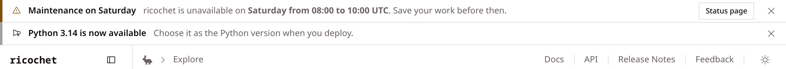
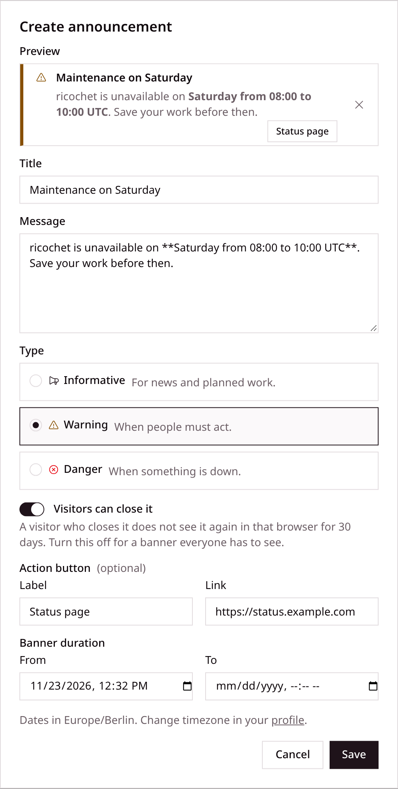
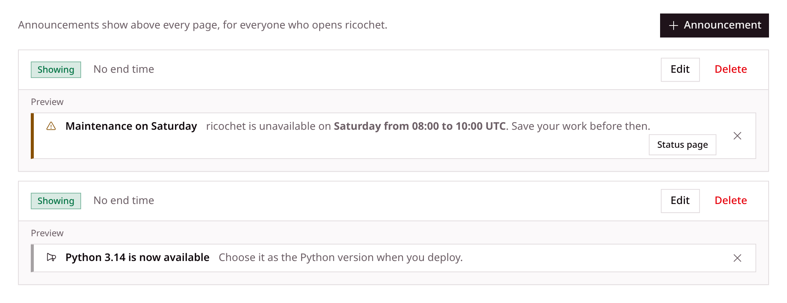

Show a notice above every ricochet page, for everyone who visits, including people who are not signed in.
You need the admin role.

1. Open **Server Settings** and select **Announcements**.
2. Select **Announcement** and enter a title and a message.
3. Choose a **Type**.
4. Select **Save**.

The announcement shows as soon as you save it, unless you move **From** to a later time.
The preview at the top of the editor shows how the banner looks with its message expanded.
Your apps do not show announcements, because ricochet shows them only on its own pages.

## Choose a type

| Type          | When to use it          |
| ------------- | ----------------------- |
| **Informative** | For news and planned work |
| **Warning**     | When people must act    |
| **Danger**      | When something is down  |

Every type shows on the page's own background, and the type sets the color of the banner's left edge and icon.

## Format the message

The message supports Markdown: bold, italic, strikethrough, code, links, and lists.
Links can use `http`, `https` or `mailto`.
ricochet shows raw HTML as text and leaves out images and headings.
The title is always plain text.
On a phone, the banner shows only its title until a visitor expands it.

## Add a button

Under **Action button**, enter a **Label** and a **Link** to show a button at the end of the banner.
The link can start with `https://`, `http://` or `mailto:`, or with `/` for a page on your ricochet server.
Leave both empty for a banner without a button.

## Let visitors close it

**Visitors can close it** is on for a new announcement.
A visitor who closes the banner does not see it again in that browser for 30 days.
Editing the announcement keeps it closed for them.
Turn off **Visitors can close it** to show it to everyone again.
Turn it off for a banner everyone has to see until it ends.

## Limit the time

**From** starts at the current time, and **To** starts empty.
To end the announcement at a set time, enter it in **To**.
To schedule it, move **From**.
**To** has to be later than **From**.

Without an end time, the announcement shows until you delete it.
Both times use the time zone in your ricochet profile.

## Status

| Status      | What it means                                       |
| ----------- | --------------------------------------------------- |
| `Scheduled` | The time frame has not started                      |
| `Showing`   | The time frame is running                           |
| `Ended`     | The time frame is over, and ricochet keeps the text |

The **Announcements** tab shows each banner as an expanded preview.
Above each preview, the tab shows the status, when the banner ends, and the **Edit** and **Delete** buttons.

To take an announcement down early, select **Delete**.
To end it early but keep its text, select **Edit** and enter the current time in **To**.
People with a page already open see a change within a minute.

## Limits

- A title can have 120 characters, a message 1000, and a button label 40.
- A tall stack of announcements scrolls inside the banner area, which takes up to a quarter of the window.
