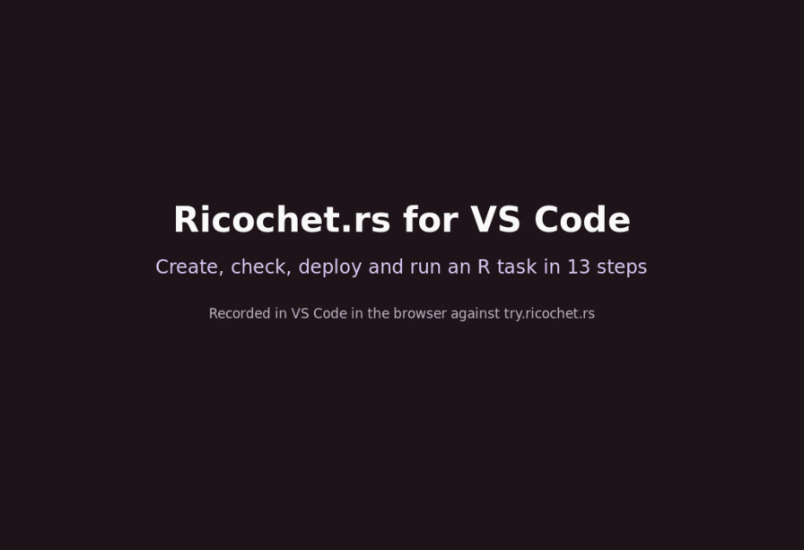
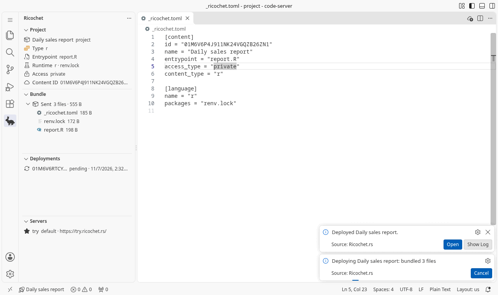
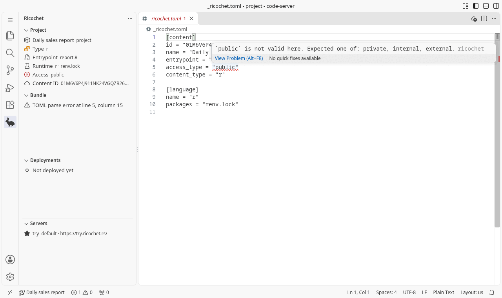

import { Aside, Steps } from "@astrojs/starlight/components";

The Ricochet.rs extension lets you deploy, run tasks, and check your `_ricochet.toml` without leaving VS Code or Positron.
It runs the [ricochet CLI](/dev/user/deployment/1-ricochet-cli/) for you, so install the CLI first.

## Install

<Steps>

1. Install the [ricochet CLI](/dev/user/deployment/1-ricochet-cli/#installation), version 1.4.0 or newer.

2. Open the **Extensions** view in your editor.

3. Search for **Ricochet.rs** and select **Install**.

</Steps>

VS Code installs it from the [Visual Studio Marketplace](https://marketplace.visualstudio.com/items?itemName=ricochet.ricochet-rs).
Positron, Cursor, and other editors install it from [Open VSX](https://open-vsx.org/extension/ricochet/ricochet-rs).

<Aside type="tip">
  Run `ricochet self update` when the extension reports an older CLI.
</Aside>

## Sign in

<Steps>

1. Open the **Ricochet** view in the activity bar.

2. Select **Add Server** in the **Servers** view and enter your server URL.

3. Select **Login** and paste an API key.
    The prompt has a button that opens the server page where you create one.

</Steps>

## Deploy

Open a folder that holds a `_ricochet.toml`, then select **Deploy** in the **Project** view.
If the folder has no `_ricochet.toml`, select **Create \_ricochet.toml** to select an entrypoint and write one.

The extension shows how many files it bundled, then offers to open the deployed item in your browser.

## What else you can do

- Fix `_ricochet.toml` mistakes while you type, since the editor checks it with the same rules as the server and completes every key and value.
- See every file a deploy would upload in the **Bundle** view, and why the others are left out.
- Start a task with **Run Task Now** and read what it printed with **Show Output**.
- Follow an item's history in the **Deployments** view and open any deployment in the browser.

## Settings

| Setting                       | Default | Purpose                                                                     |
| ----------------------------- | ------- | --------------------------------------------------------------------------- |
| `ricochet.cli.path`           | `""`    | Path to the `ricochet` executable. Empty searches your `PATH` first.        |
| `ricochet.server`             | `""`    | Server name or URL to deploy to. Empty uses the CLI's default server.       |
| `ricochet.deploy.confirm`     | `true`  | Ask before each deploy.                                                     |
| `ricochet.validation.enabled` | `true`  | Show `_ricochet.toml` problems in the editor.                               |

## Troubleshooting

- If the extension cannot find the CLI, set `ricochet.cli.path` to the full path of the `ricochet` executable.
- If a deploy fails because your key is missing or expired, select **Sign In** on the error and paste a new API key.
- Run **Ricochet: Show Log** from the Command Palette to read the CLI's full output.
